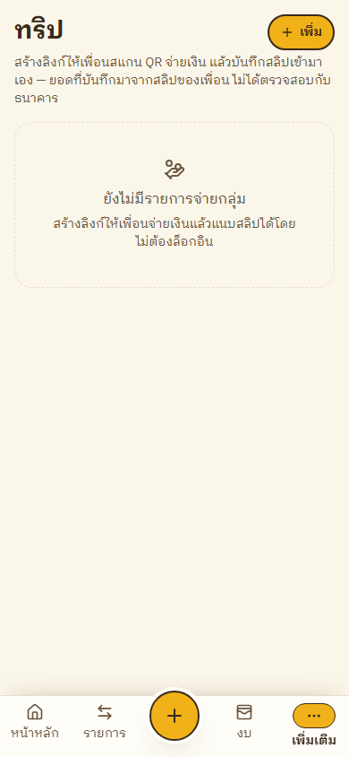
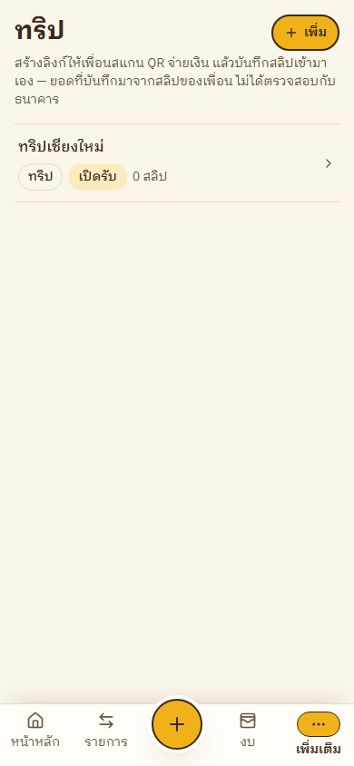
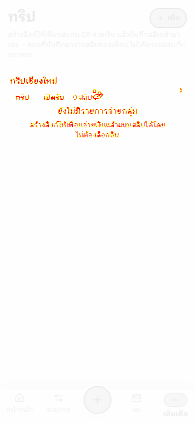
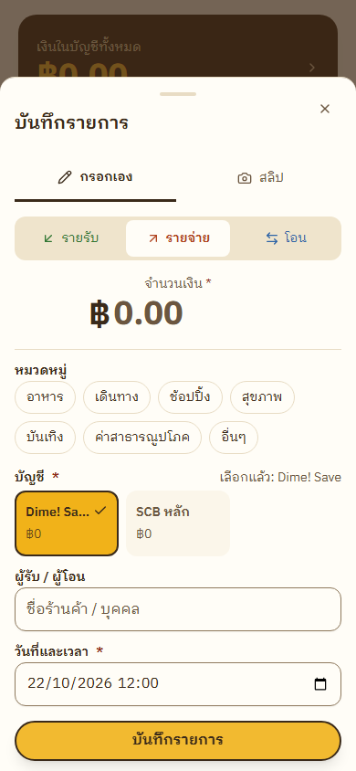
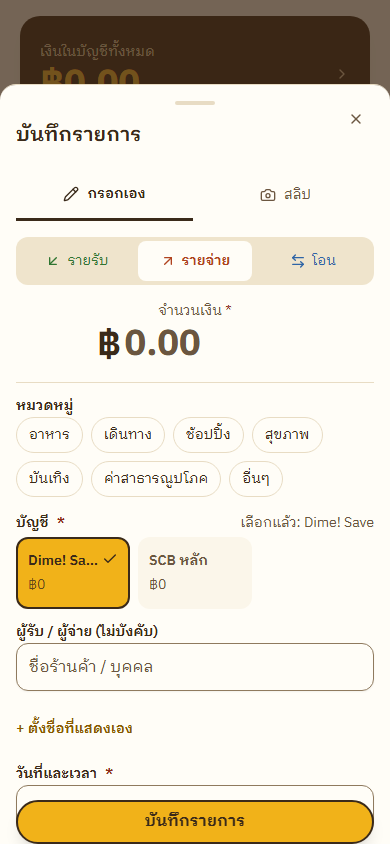
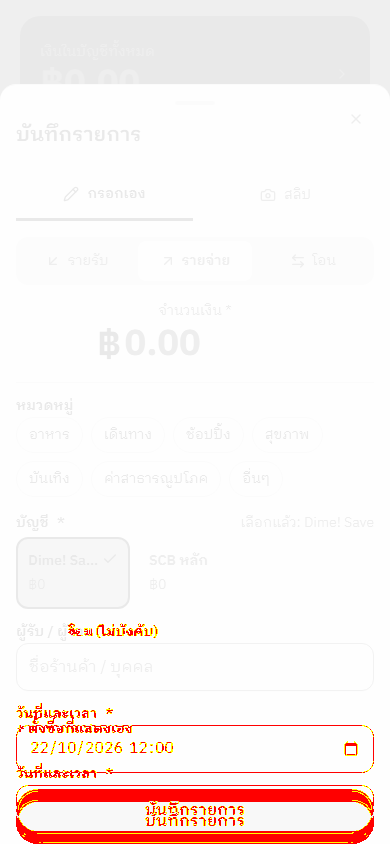

# Visual baseline review — 2026-10-31

## Original light-sessions mismatch (1,869 pixels)

The actual image contains an A-owned `ทริปเชียงใหม่` test session. `resetAllUserData` did not clear `payment_sessions`; the visual fixture now calls the existing test-user-scoped `clearOwnerSessions`. The focused production run passed the unchanged snapshot.

| Expected | Actual | Diff |
| --- | --- | --- |
|  |  |  |

## Newly exposed light-add-manual mismatch (11,555 pixels)

The current sheet includes an optional display-name control absent from the snapshot. `git log -S 'displayName' -- components/transaction-form.tsx` identifies `45f8c62` as the UI addition. This is intentional UI drift, but the visual baseline has **not** been updated pending owner review.

| Expected | Actual | Diff |
| --- | --- | --- |
|  |  |  |
